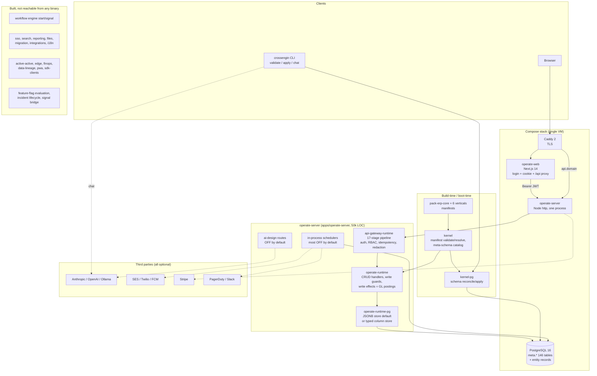

# CrossEngin — Technical Due-Diligence Report

| | |
|---|---|
| Target | `amoufaq5/CrossEngin`, commit `7bc8db9` (2026-10-14) |
| Audit date | 2026-11-15 |
| Method | Inventory → per-module review by 22 reviewers (ledger in `coverage.md`, per-module findings in `modules/R01…R22.md`) → build/test/audit runs → live verification against a local PostgreSQL 16 and the real server → consolidation |
| Evidence labels | **LIVE** = reproduced by the lead auditor on a running server (test numbers `L1…L32` refer to `01_commands_and_results.md`). **CONFIRMED** = code path read end to end. **LIKELY** = strong evidence, one hop unverified. **SUSPECTED** = needs follow-up. |

No source file was modified. Nothing was pushed. No production system or third-party API was contacted.

---

## 1. Executive summary

**What it is.** CrossEngin is a platform for generating multi-tenant business applications from a declarative description ("manifest"). A manifest lists entities, fields, roles, permissions and lifecycles; the server turns it into a REST API and a generic web UI. An ERP "core pack" (51 entities: ledger, invoices, bills, payments, inventory tables, HR, tax tables) and six small vertical packs ship as manifests. An LLM can draft a new manifest from a paragraph of prose. The code is ~225,000 lines of TypeScript plus ~250,000 lines of tests, written by one author in roughly two months with heavy AI assistance.

**How mature it is.** It is a well-typed, extensively unit-tested **prototype of a platform**, not a production ERP. The engineering discipline on the surface is real: strict typing, 18,929 passing tests, 94 % line coverage, parameterised SQL throughout, tenant isolation that held in every live test. Underneath, three things are true at once:

1. **The accounting core is not safe to keep books on.** On the running system I unbalanced a posted journal entry with one API call, posted the same bill to the ledger three times, and created a bill already marked "paid" using a role that has no approval or payment rights. Money arithmetic uses binary floating point. There is no inventory, costing or COGS logic at all.
2. **The deployment that ships switches most safeguards off.** With the provided Docker Compose file there is no audit trail (zero audit rows after 40 writes), no rate limiting, no backups, no monitoring, search returns an error, uniqueness and referential integrity are not enforced, and the database's row-level security is bypassed because the application connects as a superuser.
3. **Much of the repository is specification, not product.** 14 of 87 packages are imported by nothing. SSO, reporting, search, file storage, data import, integrations (HL7/EDI), multi-region, feature flags, incident management, workflows and all 25 scheduled/event jobs are either schemas with no executor or executors nothing calls. Compliance outputs (DR readiness, access reviews, "certifiable" reports) can report success with no evidence behind them.

**The "AI".** One feature: generate a starting manifest from prose (off in the default deployment), plus a developer command-line chat. The output is properly validated before use, which is good. There is no AI working on business data (no document extraction, forecasting, natural-language query, copilots), no retrieval, and no evaluation suite. It is a thin, replaceable wrapper around third-party models; the defensible asset is the manifest compiler, not the AI.

**Top five risks**

| # | Risk | Why it matters |
|---|---|---|
| 1 | Ledger integrity can be broken through the ordinary API (posted entries unbalanced, documents double-posted, approval steps skipped) | Financial statements produced by the system cannot be trusted; fixing it means redesigning how state changes and postings are guarded, not patching |
| 2 | Credentials committed to the repository: an Anthropic-format API key and a database password in `deploy/.env.example` on `main` | Must be treated as compromised today; also shows there is no secret scanning or review gate |
| 3 | No audit trail, no backups, no CI, no monitoring in the shipped configuration; one author; no independent code review | Operating this for a paying customer would fail a basic vendor-security questionnaire; bus factor is one |
| 4 | Authentication and authorisation gaps: no MFA or password reset, no session revocation, a lockout that both fails to stop parallel guessing and lets anyone lock a user out, "four-eyes" approvals that are a free-text field, and a data-subject erasure request that deletes the entire tenant | Account takeover, denial of service, and a catastrophic GDPR handling error |
| 5 | Breadth far exceeds depth: documentation and package names describe capabilities the code does not deliver | Valuation risk — a buyer reading the docs would overestimate the product by a wide margin |

**Verdict.** Do not put customer financial data on this system as it stands. As an acquisition it is worth evaluating as (a) a manifest-to-application engine with a careful type and validation layer, and (b) a detailed design corpus — not as a working ERP and not as an AI product. Reaching a defensible single-tenant pilot is a multi-quarter effort for a small team (section 7); reaching what the documentation describes is a multi-year one.

---

## 2. Scorecard

| Area | Score | Justification |
|---|:---:|---|
| Architecture | 5 | Clean contract → runtime → persistence layering and a single schema source of truth. Offset by a 3,492-line `serve()` function (complexity 504) wiring 144 flags, in-process schedulers and per-process state that block horizontal scaling, and ~17 % of packages with no caller. |
| Domain correctness (ERP) | 2 | Balance check on posting and immutability of posted entries exist and work on the direct path, but are bypassed three different ways (LIVE). Float money, hard-coded 2 decimals, FX rate fixed at 1 on automatic postings, credit notes ignore tax, period locks partial, no inventory/COGS, no tax localisation, numbering not gapless. |
| AI integration | 3 | Output is schema-validated and the server-side model has no tools — genuinely careful. But one feature, no evals, cost ceilings not wired, reviewer diff hides 11 of 16 manifest sections, CLI file tools unconfined, stale model/pricing tables. |
| Security | 3 | Strong points: parameterised SQL everywhere, EdDSA-only JWT with `kid`, default-deny RBAC, scrypt + pepper, security headers. Weak points: committed secrets, RLS inert, SQL injection sink in manifest defaults, optional JWT claims, no MFA/reset/revocation, broken lockout, self-asserted four-eyes, mass assignment, no rate limiting by default, Next.js with known critical advisories. |
| Data layer | 4 | Thoughtful catalog (146 tables, RLS policy on every tenant table, `TIMESTAMPTZ`, no float money columns). But business data lives in one JSONB table with one index on the default store, no enforced uniqueness or foreign keys there, no partitioning/retention, migrations with no down path that lock large tables, pool with no timeouts or error handler. |
| Code quality | 5 | Strict TypeScript, 9 `any` occurrences in all non-test source, no TODO/FIXME markers, consistent patterns, no skipped tests. Against: 122 functions over 100 lines, heavy copy-paste across the `*-pg` packages, 19 % comment lines many of which assert properties the code does not have, large dead-code volume. |
| Testing | 4 | 94.2 % line coverage and 18,929 fast tests — but not one test runs SQL against a real database; tenant isolation and concurrency are asserted against in-memory imitations; accounting tests use round numbers; zero UI tests, zero property/load tests, zero AI evals; the composition root is 17 % covered. Every live defect in this report passed the full suite. |
| DevOps / operations | 2 | One Docker Compose stack. No CI, no hooks, no linting, no backups, no metrics/tracing/log shipping, no rollback, single-stage root image with dev dependencies, floating image tags. Health checks and boot-time diagnostics are good. |
| Documentation | 3 | Enormous volume (358 ADRs, a 610 KB state file) and an unusually candid internal defect register. But the README describes a different codebase (51 packages vs 87), the foundational ADRs describe a system that was not built, setup guides contain steps that cannot work, and there is no API reference. |
| Production readiness | 2 | See risks 1–4. |
| **Overall** | **3** | A disciplined prototype with a real engine at its centre, surrounded by unexecuted design, shipped in an unsafe default configuration, with a ledger that can be corrupted through its own API. |

---

## 3. Architecture

### 3.1 Diagram

### 3.2 Description

- **Shape:** a modular monolith. One long-running Node process (`operate-server`) serves every tenant from one PostgreSQL database. The web app is a thin Next.js proxy and generic renderer. There are no queues, caches or brokers; background work is `setInterval` loops inside the API process.
- **Layering:** each domain is split into a pure "contracts" package (zod schemas, state machines), an in-process `-runtime`, and a `-pg` persistence sibling. Dependency direction is consistently inward and this is the strongest design property of the codebase.
- **Schema:** there are no SQL migration files. Platform tables are declared in a 12,181-line TypeScript catalog (`packages/kernel/src/bootstrap/meta-schema.ts`) and reconciled against `pg_catalog`; tenant entity tables are generated from the manifest at boot.
- **Composition root:** `apps/operate-server/src/node.ts:883` `serve()` is 3,492 lines with cyclomatic complexity 504; `cli.ts:528` `parseServeArgs` is 1,495 lines with complexity 489. Behaviour is selected by 144 command-line flags. Test coverage of `node.ts` is 17.3 %.
- **Two storage models behind one interface:** the default (`--store pg`) keeps every record of every entity of every tenant in one JSONB table (`meta.operate_entity_records`); the alternative (`--store pg-columns`) creates typed tables. They differ in enforced constraints, search, and uniqueness, so behaviour depends on a deployment flag.

### 3.3 Core ERP data flows (traced in code; R01, R02)

| Flow | What exists | What is missing |
|---|---|---|
| Sales order → invoice → payment → ledger | Invoice `send` posts AR / revenue / tax to the GL; a payment referencing an invoice posts cash / AR and auto-settles when fully paid; FX gain/loss on settlement; credit notes | Sales order → invoice is manual re-keying (no conversion); shipments do not touch stock or revenue; invoices with withholding never auto-settle; credit-note reversal ignores tax |
| Purchase order → goods receipt → bill → payment | Bill `approve` posts expense / AP; outbound payment posts AP / cash | No PO→receipt→bill matching (2- or 3-way); goods receipt has no lines and no effect; bill void and payment refund post nothing |
| Inventory → COGS | `Item`, `StockLevel`, `StockMovement`, `Warehouse` tables exist as CRUD | **No stock decrement, no valuation method (FIFO/average), no COGS posting, no negative-stock guard — zero code** |
| Period close | Fiscal periods, a lock guard for manual entries, an FX revaluation effect | Lock does not apply to system postings; revaluation is cumulative and never reversed; no closing entries |

### 3.4 Scalability and single points of failure

- One API process, one database, one VM. `deploy/README.md` says the API is stateless and can be replicated; it is not: rate-limit windows, the per-tenant gateway cache, usage metering buffers, workflow signal routing and the SLO window are per-process, and the schedulers have no leader election (duplicate cron enqueues across replicas; R15-09, R08-13).
- The database pool has no error listener, no statement/lock/idle timeouts and default sizing (`packages/kernel-pg/src/node-pg.ts:87-95`). An idle-connection error during a database restart or failover is an unhandled `error` event, which terminates the process (R04-01, CONFIRMED by code; not crash-tested).
- All business data for all tenants in one JSONB table with a single index, searched with `unaccent(...) ILIKE '%…%'` (sequential scan), sorted on `document ->> 'field'`. This will not survive a tenant with a few hundred thousand rows.
- Boot runs DDL: on the column store every foreign key is dropped and re-added and indexes are built non-concurrently on every start (R03-05).
- **Is it appropriate for a 10-year ERP?** The manifest approach is a reasonable foundation for heavy customisation. The current persistence model, the flag-driven composition root and the absence of an upgrade/rollback path are not. Schema evolution is additive-only: a renamed or retyped field is never migrated.

---

## 4. Findings table

Severity: Critical / High / Medium / Low. Effort: S (< 1 week), M (1–4 weeks), L (> 1 month) for one experienced engineer. Paths are relative to the repository root. IDs in the last column point to the module reports with full evidence.

### Critical

| ID | Category | Title | Where | Evidence | Impact | Fix | Effort | Ref |
|---|---|---|---|---|---|---|:-:|---|
| C-01 | Secrets | Credentials committed on `main` | `deploy/.env.example:5`, `:117` | Line 117: a commented value in live Anthropic key format (`sk-ant-usr-1…`). Line 5: `POSTGRES_PASSWORD=Ams8…` (non-placeholder). Introduced by commit `7bc8db9`. Validity not tested. | Third-party spend / data exposure on the vendor account; database compromise if the password is in use anywhere | Revoke and rotate both now; purge from history; add secret scanning as a merge gate | S | R13-01, R09-01 |
| C-02 | Accounting | Posted journal entry can be unbalanced by re-parenting a line | `packages/operate-runtime/src/write-guards.ts:227-236` | **LIVE L13.** The child guard resolves the parent as `after[parent] ?? before[parent]`, so it only checks the *new* parent. `PATCH /v1/journal-lines/{id} {"journal_entry_id": <draft>}` moved the credit line out of a posted 500/500 entry; it now holds 500 Dr / 0 Cr. Same applies to invoice lines. | The general ledger can be made not to balance through the normal API by any role with line update rights | Check both old and new parent; add a database-level constraint or trigger for balance on posted entries | M | R01-03 |
| C-03 | Accounting | Lifecycle `state` is an ordinary writable field; documents can be double-posted and approvals skipped | `packages/operate-runtime/src/handlers.ts:467-555`, `compile.ts:271-336` | **LIVE L15:** PATCHing a bill `draft→approved→draft→approved→draft→approved` returned 200 each time and produced three posted journal entries all numbered `BILL-2026-00002-GL`. **LIVE L17:** role `ap_clerk` (no approve/pay grant) created a bill already in state `paid` for 999,999.00. Only five entities have a lock guard; Bill, Payment, Expense, FiscalPeriod, WhtCertificate have none. | Duplicate expense/AP postings; transition permissions are decorative; segregation of duties cannot be enforced | Make `state` server-owned (reject on create/update); route all changes through transitions that check `fromStates` and grants under a row lock; make postings idempotent per document | M | R01-01, R02-01 |
| C-04 | Privacy | A data-subject erasure request erases the entire tenant | `apps/operate-server/src/node.ts:3534-3556`, `:1750-1768`; `packages/tenant-lifecycle-pg/src/deletion-runner.ts:83-90` | CONFIRMED (read by lead auditor). The asynchronous runner calls `deleteTenantAtomically` with `kind: "data_subject_erasure"`; `subjectIdentifier` is stored on the request and never passed to the eraser, which runs a tenant-wide `DELETE` plus `DROP SCHEMA`. | One person's GDPR request destroys every record of the customer organisation, irreversibly, with no backup in the shipped stack | Disable the runner until per-subject erasure exists; rename the kind to what it does; require explicit tenant-level confirmation | S (disable) / L (build) | R10-09, R17-14 |
| C-05 | Audit | No audit trail in the shipped deployment, and entity writes never reach the audit log in any configuration | `deploy/docker-compose.yml:147-175`; `apps/operate-server/src/audit-chain.ts:154-173`; `packages/operate-runtime` (no audit emitter reference) | **LIVE L8:** 0 rows in `meta.audit_log` and `meta.forensic_chain_entries` after ~40 writes incl. posting and reversing journal entries. With audit flags on, entity writes produce only a sampled, asynchronous hash entry containing no entity id and no before/after values (CONFIRMED). `created_by`/`updated_by` are never stamped. | "Who changed what, when" cannot be answered for any business record. Fails any financial-systems or SOC 2 control | Write a mandatory, unsampled audit row (actor, entity, id, before/after) in the same transaction as each write; stamp actor on records | M | R10-01, R10-02, R02-02 |

### High

| ID | Category | Title | Where | Evidence | Impact | Fix | Effort | Ref |
|---|---|---|---|---|---|---|:-:|---|
| H-01 | Tenancy | Row-level security is inert in the shipped stack | `deploy/docker-compose.yml:11-16`; `packages/kernel/src/bootstrap/emit.ts:414-416` | **LIVE L1:** application role `rolsuper = t`; 0 of 115 RLS tables use `FORCE ROW LEVEL SECURITY`. Isolation rests only on `tenant_id = $1` predicates in application SQL (present on every statement traced; cross-tenant API tests L2/L3 passed). | One missing predicate in any future query is a cross-tenant leak with no second barrier | Run the API as a non-owner, non-superuser role; add `FORCE`; run the migrator as a separate owner role | M | R03-02, R05-02, R13-02 |
| H-02 | Injection | SQL injection sink: manifest field default "expression" is concatenated into DDL | `packages/types/src/meta-schema/field.ts:45-48`; `packages/kernel/src/ddl/column.ts:14-15`; `packages/operate-runtime-pg/src/entity-ddl.ts:263`; executed at `tenant-schema-apply.ts:249-251`, `column-store.ts:291` | **L31:** a manifest with `expression: "'a'); CREATE TABLE public.pwned(x int); --"` passed `validateManifest` and the emitted `CREATE TABLE` contained the injected statement. Reach requires `--store pg-columns` and either a boot manifest or an activated per-tenant (AI- or user-authored) manifest; the reviewer diff does not show defaults. Executed as the DB superuser in compose. End-to-end execution not performed. | Arbitrary SQL as superuser by anyone who can get a manifest activated, including via prompt injection into the AI designer | Remove the `expression` kind or restrict it to an allow-list (`now()`, `gen_random_uuid()`); never interpolate manifest strings into SQL | S | R03-01, R05-01 |
| H-03 | AuthN | JWT `exp`, `iss`, `aud`, `sub` are checked only if present; tenant falls back to a client header | `packages/api-gateway-runtime/src/auth.ts:136-152, 202-213`; `runtime.ts:360-371`; `apps/operate-server/src/principals.ts:91-108` | **LIVE L28/L29:** a correctly signed token with no `exp`/`iss`/`aud` was accepted; a token with no `tenant_id` wrote into tenant B by sending `x-tenant-id`. Built-in login always sets the claims, so the default path is unaffected. | With an external identity provider (`--jwks-url`), tokens that never expire and tenant selection by header | Require all four claims and the tenant claim; never read tenant from a header for bearer tokens | S | R06-01, R06-02, R09-06 |
| H-04 | AuthZ | Role comes from the first token `scope`; platform authority is a bare role name; membership role is a free string | `apps/operate-server/src/principals.ts:104,155-159`; `platform-admin.ts:372-384`; `platform-users.ts:179, 733-742` | CONFIRMED. No membership lookup at request time; `platform_admin` checks compare a role string only, with no binding to a platform tenant; whoever can grant memberships can grant `platform_admin` or the four-eyes roles to themselves. | Privilege escalation from user-administration to full platform control incl. tenant deletion | Separate platform principals from tenant principals; validate granted roles against an allow-list; bind platform routes to the platform tenant | M | R09-05, R06-03, R10-11 |
| H-05 | AuthZ | "Four-eyes" on destructive routes is a self-asserted text field | `apps/operate-server/src/tenant-deletion-routes.ts:393-399` (verified); `tenant-erasure-routes.ts:310-318`; `deletion-request-routes.ts:309,482`; `deletion-scheduler.ts:19-20` | The approver is a string in the request body that only has to differ from the caller's id; the scheduled runner uses two constants. | Irreversible tenant deletion by a single actor while the record claims dual control | Require a second authenticated principal's approval recorded server-side | M | R10-10, R17-17 |
| H-06 | AuthN | Login lockout neither stops parallel guessing nor resists abuse; no rate limit in front of scrypt | `apps/operate-server/src/auth-token-route.ts:220-263, 419`; `credential-store.ts:155-159` | **LIVE L25:** 40 parallel wrong guesses all evaluated (counter 40, threshold 10). **LIVE L26:** after lock expiry one wrong guess re-locks; the correct password is refused while locked. Each attempt costs ~100–130 ms of CPU on a 4-thread pool. | Online guessing is bounded only by CPU; any user can be locked out indefinitely by anyone who knows their e-mail; CPU exhaustion pre-auth | Atomic check-and-increment; reset the counter on expiry; per-IP and per-account rate limits; exponential back-off instead of hard lock | S | R09-02, R09-03 |
| H-07 | AuthN | No session revocation, no MFA, no password reset or change, no password policy | `apps/operate-server/src/token-mint.ts:116-125`; `apps/operate-web/app/api/auth/logout/route.ts` | **LIVE L27:** token still valid after user suspension and membership revocation. Logout clears a cookie only. Password reset is a server-side CLI command. | Stolen tokens valid for up to 24 h (1 h default); unusable for any customer with a security policy | Short-lived access tokens + server-side refresh/revocation; MFA; self-service reset | M | R09-04, R09-07, R13-07 |
| H-08 | Integrity | Mass assignment of server-owned fields; unknown fields stored | `packages/operate-runtime/src/handlers.ts` (create/update), `validation.ts` | **LIVE L6:** client-supplied `id`, `created_at` (later rewritten to 1999 by PATCH), a `tenant_id` field and an undeclared field `bogus` were all persisted. | Forged timestamps, client-chosen document numbers (L12), schema drift inside JSONB | Strip or reject server-owned and undeclared fields | S | — |
| H-09 | Integrity | Default store enforces neither uniqueness nor references | `apps/operate-server/src/unique-enforcement.ts` (boot report); `packages/operate-runtime/src/handlers.ts:556-598` | **LIVE L5, L18:** duplicate `vendor_code` accepted; a ledger account used by posted lines deleted (204); a line referencing a non-existent account accepted. Boot log: "declared unique fields: 0 of 32 enforced". | Duplicate invoice numbers, orphaned postings | Make the typed column store the only supported store, or implement both checks in the JSONB store | M | R02-06 |
| H-10 | Accounting | Balance is enforced in application code on one path only; functional-currency amounts unchecked; born-posted entries allowed | `packages/operate-runtime/src/write-guards.ts:108-140` | **LIVE L11:** posted with functional 100 Dr / 7 Cr. **LIVE L12:** entry created directly as `posted` with no lines and a client-chosen number. **LIVE L14:** `reversed` entries are editable. No database constraint; tolerance 0.005 on floats. | Reporting-currency ledger can be unbalanced by construction | Enforce on every write path and in the database; validate functional amounts = amount × rate | M | R01-02, R01-04 |
| H-11 | Accounting | Money arithmetic uses JavaScript floats with nine hard-coded 2-decimal rounding sites | `packages/operate-runtime/src/write-effects.ts:846, 864, 875-894, 1034, 1456, 1486` | `Math.round(13.40 × 0.075 × 100)/100` = 1.00 (exact 1.005 → 1.01), reproduced. `Currency.decimal_places` has no reader. Automatic postings hard-code `fx_rate: 1`. | Penny errors on tax; 3-decimal currencies (KWD, BHD, JOD) and 0-decimal currencies wrong; multi-currency ledgers wrong | Use integer minor units or a decimal library end to end; read currency precision | M | R01-06, R01-07 |
| H-12 | Accounting | Transitions take no row lock; optimistic concurrency is optional and non-atomic | `packages/operate-runtime/src/handlers.ts:646-689`; `packages/operate-runtime-pg/src/entity-ops.ts:126-138`; `column-store.ts:446, 529` | CONFIRMED by code: READ COMMITTED, `get` without `FOR UPDATE`, blind `UPDATE`. Not race-tested live. | Concurrent `send`/`approve`/payment requests double-post or lose settlement | `SELECT … FOR UPDATE` in the write transaction; mandatory version check | M | R01-05, R03-03 |
| H-13 | Accounting | Credit notes ignore tax; bill void and refunds post nothing; period lock skips system postings; FX revaluation never reverses | `packages/operate-runtime/src/write-effects.ts:412-474` and related | CONFIRMED by reading. | Tax liability and AP/AR overstated after corrections; closed periods receive postings | Complete the posting rules; apply the lock to all sources | M | R01-08…R01-11 |
| H-14 | Product gap | No inventory, costing, COGS, document matching, bank reconciliation, depreciation or payroll logic | `packages/operate-runtime/src` (absence); `packages/pack-erp-core` | CONFIRMED by grep: the tables exist as CRUD only. | Not an ERP for any business that holds stock or fixed assets | Build | L | R01-12, R02-04 |
| H-15 | Compliance | No tax localisation or e-invoicing (Egypt ETA, KSA ZATCA, UAE, EU) | `packages/pack-erp-core/src/jobs-ext.ts:73` (sole mention, in an unimplemented job description) | `TaxRule`/`TaxJurisdiction` are never read; sequences are not gapless (**LIVE L20**) | Cannot be sold where e-invoicing or gapless numbering is mandatory | Build per jurisdiction; gapless allocator inside the write transaction | L | R02-05, R03-06 |
| H-16 | Product gap | 0 of 25 declared jobs have a handler; event names can never match | `apps/operate-server/src/node.ts:3374` (`JOB_HANDLER_PROVIDERS = []`, verified); `packages/operate-runtime/src/entity-events.ts:68` vs `packages/pack-erp-core/src/jobs-ext.ts:66-124` | CONFIRMED. | Invoices never go overdue, no dunning, no month-end job, no depreciation run | Add an executable binding to job declarations and implement handlers | L | R02-03, R14-07 |
| H-17 | Product gap | Workflow engine is unreachable; if wired it has correctness defects | `packages/workflow-runtime/src/engine.ts:1216` (only `startInstance` caller); `saga.ts:23-70`; `engine.ts:1966-2036`; `packages/workflow-worker/src/job-batch.ts:68-96`; `packages/workflow-runtime-pg/src/job-engine.ts:293, 311-336` | CONFIRMED: no route starts an instance. Latent defects: saga compensates steps that never ran and once per retry; failed compensation recorded as done; batch leases lapse (double execution); no fencing; a throwing handler loops forever. | No approval workflows today; unsafe to enable as is | Wire deliberately after fixing lease/fencing/compensation | L | R14, R15 |
| H-18 | Audit | Hash chain is not tamper-evident against anyone with database write access | `apps/operate-server/src/chain-verify.ts:88-110`; `integrity-proof.ts:61`; `checkpoint-scheduler.ts:159-172`; `packages/kernel/src/bootstrap/meta-schema.ts:483-485, 11221` | CONFIRMED: default verification skips everything before the last checkpoint; no verifier recomputes entry hashes; checkpoints are unsigned and stored in the same database as the chain and the verification keys; policies allow UPDATE/DELETE; deleted audit rows are undetectable; only the newest 500 rows are checked; the signing key is a plaintext file. | The "tamper-evident audit" claim holds only against a tenant using the API | External anchoring, append-only grants, full verification, signed checkpoints | M | R07-01, R07-02, R10-04…R10-07 |
| H-19 | Compliance | Compliance outputs report success with no evidence | `packages/dr-runtime/src/readiness.ts:82-156`; `packages/access-reviews/src/evidence.ts:69-78`; `packages/access-reviews-runtime/src/enforcement.ts:46-81`; `packages/certification-runtime/src/report.ts:53-69,125` | CONFIRMED: `assessDrReadiness({})` → ready; an access-review campaign with zero items seals at 100 %; "auto-revocation" revokes nothing while logging `revoked=n`; the report is a 4-control self-assessment worded "CERTIFIABLE". | Presenting these to a customer or auditor as evidence would be a misrepresentation | Fail closed on missing evidence; rename; remove until real | S | R19-01…R19-07, R18-03, R11-11, R11-12 |
| H-20 | Privacy | No Article 15/20 path, no deadline detection, erasure proof silent about retained personal data and backups | `apps/operate-server/src/deletion-request-routes.ts`; `packages/tenant-lifecycle-pg/src/shared-table-erasure.ts:93-137,323` | CONFIRMED. `meta.users` (name, e-mail, phone) survives tenant erasure; the proof can only complete when backups are declared "absent". | GDPR/PDPL non-compliance despite extensive erasure machinery | Build access/export; honest proof vocabulary; overdue alerts | L | R10-13, R17-16, R17-20 |
| H-21 | Operations | Database pool has no error handler, timeouts or sizing | `packages/kernel-pg/src/node-pg.ts:87-95` (verified) | CONFIRMED by code. | API process exits on database restart/failover; one slow query can hold a connection forever | Add `pool.on('error')`, statement/lock/idle timeouts, explicit `max` | S | R04-01, R03-09 |
| H-22 | Operations | No CI, no hooks, no lint, no backups, no monitoring, no rollback | repository root (no `.github/`); `deploy/docker-compose.yml`; lint run exit 1 | CONFIRMED. `console.*` at 232 sites is the only logging. A 500 on a write produced no server log line (observed during L-tests). | Regressions ship unnoticed; data loss is unrecoverable; incidents are invisible | CI with tests + audit + secret scan; scheduled `pg_dump`/PITR with restore drill; structured logs and metrics | M | R13-11/12, R18-04, R21-04 |
| H-23 | Operations | Migrations lock large tables, have no down path, and "plan" mode is not read-only | `packages/kernel-pg/src/reconcile.ts:373-384, 457-468, 964-977`; `expression-render.ts:145-149`; `bin/crossengin-pg.ts:44-61` | CONFIRMED by code: non-concurrent index builds, `DROP INDEX; CREATE INDEX` in one transaction, no `lock_timeout`; drift check runs `ALTER TABLE … ADD CONSTRAINT … NOT VALID`; unknown CLI flags are silently dropped, so `apply --dryrun` applies. Compose runs `apply --confirm` on every `up`. | Outage on upgrade of a populated database; accidental apply | Concurrent builds, timeouts, strict flag parsing, backup-before-apply | M | R04-02…R04-07 |
| H-24 | Functional | Search returns 500 on the default store | `packages/operate-runtime-pg/src/list-sql.ts:291, 478`; `column-store.ts:79` (only place the extension is created) | **LIVE L21:** `function unaccent(text) does not exist`. Nothing creates the extension for `--store pg`. | The UI search box fails on the shipped deployment | Create the extension in the migrate step; add an expression index | S | R03-08 |
| H-25 | Deployment | No rate limiting, tenant-status gate, write mask, cursor sealing, audit chain, schedulers or user-management routes in the shipped compose; AI overlay regresses the command line | `deploy/docker-compose.yml:147-175`; `deploy/docker-compose.ai.yml:66-82` | **LIVE L22** (300/300 requests 200). The compose enables login but not `--platform-user-routes`, so the documented bootstrap `curl` cannot work; the AI overlay drops `--credential-login` and puts the admin key back on argv. | The "turnkey" deployment is neither safe nor usable as documented | Ship a secure-by-default flag set; make safety features on-by-default in code | S | R08, R13-03, R13-04 |
| H-26 | Supply chain | `next@14.2.35` carries 2 critical and 8 high advisories | `apps/operate-web/package.json`; `audit/dependency_audit.txt` | `pnpm audit`: unauthenticated RCE in the image optimiser (AVIF), SSRF and DoS in Server Actions/rewrites, cache poisoning. Applicability to this app's usage not individually assessed. | Internet-facing UI on a vulnerable framework version | Upgrade to a patched 15.5.x line; add dependency audit to CI | S | R13 |
| H-27 | Per-tenant manifests | Bearer requests bypass the tenant's own manifest; per-tenant gateways lose rate limiting and durable idempotency; refused re-activation silently moves a tenant to another store | `apps/operate-server/src/tenant-gateway-cache.ts:43-54, 398-400`; `node.ts:3970-4011`; `packages/operate-runtime-pg/src/tenant-store-registry.ts:163-193` | CONFIRMED by code (flag-gated; not in default compose). The web UI never sends `x-tenant-id`, so UI sessions are served by the default manifest. | The headline feature (tenant-specific generated apps) does not work for logged-in users and weakens controls | Route by the authenticated tenant claim; share the checker/store; fail loudly on store flip | M | R08-01, R08-02, R03-04 |
| H-28 | AI | Reviewer approving an AI-drafted manifest cannot see most of what it changes | `apps/operate-server/src/manifest-diff.ts:341-363, 568-582, 655-738`; `apps/architect-cli/src/chat.ts:429-435` | CONFIRMED: the diff covers 5 of 16 sections and omits role inheritance, ABAC keys, field `create` grants, classification downgrades and defaults (see H-02). The CLI approval prompt shows only entity counts. Default configuration allows single-user self-activation. | A prompt-injected or mistaken manifest can weaken permissions or inject SQL and be approved unseen | Full structural diff incl. permissions and defaults; mandatory second reviewer | M | R12-10, R12-02, R12-11 |
| H-29 | AI | CLI `read_file`/write tools are not confined to the project directory | `apps/architect-cli/src/tools.ts:219, 263-286` | CONFIRMED: `resolve(rootDir, path)` with an extension check only. | Prompt injection in a file the model reads can exfiltrate any `.json/.yaml/.txt/.md` on the developer machine to the model vendor | Reject paths that resolve outside the root; show full diffs | S | R12-01, R12-03 |
| H-30 | Billing | Usage metering under-reports and re-reports | `packages/billing/src/usage.ts:52-59` and `packages/billing-runtime-pg/src/usage-store.ts:40-44` (verified); `stripe-sync.ts:66-85`; `packages/billing-runtime/src/meter.ts:24-48` | CONFIRMED by code: idempotency key truncated to the day + `quantity = EXCLUDED.quantity` (later flush overwrites earlier); after upsert the id diverges so `markSynced` matches 0 rows and usage is re-sent to Stripe as an increment each sync; buffer lost on restart. | Customers under- or over-billed | Additive upsert keyed per flush; fix id; flush on shutdown | S | R17-01…R17-03, R11-09 |
| H-31 | Notifications | Outbound notifications do not deliver real content; SMS/voice/push cannot reach a recipient; retries re-send forever; template workflow fails on a real database | `apps/operate-server/src/delivery-drain.ts:125-132, 462-529`; `delivery-store.ts:326-349`; `notification-template-store.ts:339-354` | CONFIRMED: SMS/voice are handed the user's e-mail address, push a UUID; e-mail is a fixed stub; `dueRetries` has no latest-attempt filter. Template submit/reject fail with a bind-count error (reviewer ran the literal SQL on PostgreSQL 16). | The notification subsystem is non-functional beyond in-app | Recipient directory per channel; content composer; retry state machine | M | R11-01…R11-04, R16-01, R16-02 |
| H-32 | Segregation of duties | Shipped roles allow create-vendor → bill → approve → pay by one role; controller creates, posts, reverses and reopens periods | `packages/pack-erp-core/src/permissions.ts:97, 154-155, 185-233`; `permissions-ext.ts:144` | CONFIRMED. | Fraud control absent in the reference configuration | Split roles; enforce maker ≠ checker using stamped actors (needs C-05) | S | R02-02 |
| H-33 | Team / process | Single author, no independent review, predominantly AI-generated | `git log` (50 visible commits, 1 author, 43 with AI co-author trailers); 303 of 355 ADRs "Reviewers: pending" | CONFIRMED on visible history (clone is shallow). | Bus factor 1; no second person has verified any design or code; IP position on AI-generated code should be confirmed by counsel | Independent review of security- and money-critical modules; contributor/IP documentation | — | R22 |

### Medium (selected; full detail in module reports)

| ID | Category | Title | Where | Ref |
|---|---|---|---|---|
| M-01 | Tenancy | Every RLS "elevation" (`app.platform_audit`, `*_write`, `app.platform_review`) is a session setting any connection can set; no policy names a role | `packages/kernel/src/bootstrap/meta-schema.ts:496, 518, 3777, 11372` | R05-03 |
| M-02 | Errors | Top-level handler returns raw exception text in 500 responses, reachable before authentication | `apps/operate-server/src/node.ts:585-593` (verified) | R08-03, R06-05 |
| M-03 | Edge | Rate limiting runs after authentication (failed attempts never limited); the Postgres "sliding window" counts in process memory | `packages/api-gateway-runtime/src/runtime.ts:165-183`; `packages/api-gateway-pg/src/rate-limit-checker.ts:124` | R06-07, R06-12 |
| M-04 | Edge | Idempotent replay returns an empty body (**LIVE L23**) and caches error responses | `packages/api-gateway-runtime/src/runtime.ts:662-683, 913-945` | R06-08 |
| M-05 | Edge | Security headers and redaction skipped on non-2xx; unknown role → 500; CORS unimplemented | `runtime.ts:185-191, 881-902`; `packages/auth/src/roles.ts:16-19` | R06-06, R06-10 |
| M-06 | Web | Open redirect in login `next` (`/%09/evil.com` passes) | `apps/operate-web/lib/session.ts:75-82` | R13-05 |
| M-07 | Web | Proxy has no Origin/CSRF check beyond SameSite, unbounded body buffering, no timeout; CSV formula injection in export; tenant-authored HTML rendered with `dangerouslySetInnerHTML` (SUSPECTED XSS); no CSP at the web tier | `apps/operate-web/app/api/[...path]/route.ts`; `app/e/[slug]/page.tsx:57-61`; `app/setup/page.tsx:847` | R13-06…R13-09 |
| M-08 | Web | Client-side money: 2 dp hard-coded, tenant currency appended to every amount, float re-summing, period-close truncated at 200 rows | `apps/operate-web/lib/format.ts:15-19, 62-65`; `lib/period-close.ts:52-64, 107` | R13-10 |
| M-09 | Crypto | scrypt N=2^15 below current OWASP guidance; stored parameters unbounded (CPU DoS via a crafted hash row); no pepper versioning | `packages/crypto/src/password.ts:32, 83, 99-111` | R07-09 |
| M-10 | Crypto | One environment secret derives every tenant's column key; no rotation path; `pgp_sym_encrypt` defaults (AES-128, no AEAD); only `phi`/`regulated` fields encrypted — `pii` and the whole JSONB store are plaintext | `packages/crypto/src/key-derivation.ts:275-363`; `packages/kernel-pg/src/encryption.ts:366-372` | R07-10, R04-10, R09-12 |
| M-11 | Transport | `PGSSLMODE` semantics differ from libpq (`require` does not validate; no CA can be supplied; default never attempts TLS) | `packages/kernel-pg/src/node-pg.ts:81-94` | R04-05 |
| M-12 | Data | No partitioning or retention on unbounded log tables; `meta.job_runs` filled by producers with no consumer or pruning | `packages/kernel/src/bootstrap/meta-schema.ts`; `apps/operate-server/src/node.ts:3374` | R05-10, R15-18 |
| M-13 | Data | Manifest schema has no size limits; table-name collisions (`ABTest`/`AbTest`) and reserved field names pass validation | `packages/kernel/src/manifest/types.ts:57-76`; `ddl/identifiers.ts:10-15` | R05-04…R05-06 |
| M-14 | Data | Boot DDL on the column store: every FK dropped and re-added, non-concurrent indexes, no lock | `packages/operate-runtime-pg/src/entity-ddl.ts:372-375`; `column-store.ts:284-311` | R03-05 |
| M-15 | Data | Indexes do not match queries (trigram on bare column vs `unaccent(col::text) ILIKE`); no sort/FK indexes | `list-sql.ts:291` vs `entity-ddl.ts:328` | R03-08 |
| M-16 | AI | Per-request cost ceiling and stream meter are not wired (`--ai-max-request-dollars` is a no-op); monthly budget is check-then-spend; no provider timeouts; stale model/pricing tables; `chat --provider openai` sends an Anthropic model id | `apps/operate-server/src/node.ts:2669-2674`; `apps/architect-cli/src/commands.ts:538` | R12-05…R12-09, R12-15 |
| M-17 | AI | Prompts and transcripts stored without tenant context; tenant residency ignored when choosing a provider | `packages/ai-architect-pg`; `ai-design.ts` | R12-12, R12-13 |
| M-18 | Tenancy | Tenant-status gate is opt-in and off; console status change is unguarded; tenant creation unaudited | `apps/operate-server/src/cli.ts:586`; `platform-admin.ts:413-429, 517` | R09-08, R09-09 |
| M-19 | Audit | A tenant admin can set audit sampling to 0 via settings when sampling refresh is enabled | `apps/operate-server/src/audit-sampling-policy-source.ts:57-70` | R10-03 |
| M-20 | Residency | Residency guard is fail-open on a missing header and runs before auth; one database, so no data locality | `apps/operate-server/src/server.ts:137-158` | R19-13, R08-05 |
| M-21 | Marketplace | Pack signatures verify against a key in the same payload; any `pack_author` can overwrite any published version; install is an inert row | `packages/marketplace/src/packs.ts:203-214`; `packages/marketplace-runtime-pg/src/version-store.ts:72-122` | R19-10…R19-12 |
| M-22 | Operations | No listener timeouts or connection cap; no `unhandledRejection` handler; shutdown does not drain or close the pool | `apps/operate-server/src/node.ts:4303-4372`; `bin/operate-server.ts:198-214` | R08-07, R08-08 |
| M-23 | Operations | SLO paging is lost if persistence throws after declaration; declaration failures swallowed; ongoing breach never escalates | `packages/observability-runtime-pg/src/persisting-engine.ts:78-117`; `observability-runtime/src/enforcement.ts:201-227` | R18-01, R18-02, R18-07 |
| M-24 | Docker | Single-stage image, runs as root, full source and dev dependencies, floating base tags (`ollama:latest`), no resource limits or log rotation | `deploy/Dockerfile`; `deploy/docker-compose*.yml` | R13-11 |
| M-25 | Quality | `rekeyTenant` does not lock out concurrent writers (LIKELY); stale-key cache window | `packages/crypto-pg/src/data-key-rekey.ts:318-441` | R07-11 |
| M-26 | Classification | `Contact` wholly unclassified; patient demographics `pii` not `phi` (so not encrypted); `WhtCertificate` has no permissions and is unreachable | `packages/pack-erp-core`, `pack-erp-healthcare` | R02-07, R02-10 |
| M-27 | Cron | Day-skip logic misses fires adjacent to a spring-forward DST day (reproduced by the reviewer with a standalone re-implementation) | `packages/jobs/src/cron.ts:298-307` | R14-05 |
| M-28 | Secrets | Stripe secrets are accepted on the command line only; API keys have no entropy floor and a malformed spec echoes the token | `apps/operate-server/src/cli.ts:789-797`; `principals.ts:48-65` | R08-06, R09-10 |

### Low / informational (selected)

Naive route pluralisation (`/v1/journal-entrys`, `/v1/currencys`, `/v1/bill-of-materialss`) — LIVE; duplicate id → 500 instead of 409 (L7); malformed JSON body treated as empty; LIKE wildcards in search not escaped; `Math.random` for access-review ids (`packages/access-reviews-runtime/src/clock.ts:68`); the secret-entropy check rejects ~24 % of valid `openssl rand -hex 32` values (`packages/crypto/src/key-derivation.ts:155`); `pnpm-workspace.yaml` lists two directories that do not exist; `test-fakes.ts` exported from a production index; phantom dependencies in two `package.json` files; `LICENSE` is a self-described placeholder; latent bugs in zero-importer packages (rollout percentage ineffective, SDK cursor codec corrupts non-Latin text, non-commutative CRDT merge — R20-01…03).

---

## 5. Detailed findings by area

Each subsection lists what was verified to work, then the problems, most severe first. Table IDs refer to section 4.

### A. Architecture and system design

**Works.** The contract/runtime/persistence split is applied consistently; the kernel resolves and cross-validates manifests rigorously (lineage, permissions coherence, lifecycle fields); identifier quoting for generated DDL uses a strict allow-list; boot-time "surveys" tell the operator, in plain sentences, which safeguards are missing (the server printed warnings for most of the High findings above when I started it).

**Problems.**
- *Composition by flags.* `serve()` (3,492 lines) decides everything; 144 flags; safe behaviour is opt-in. Coverage of this file is 17.3 % and one smoke test boots it on the in-memory store. The largest single maintainability and reliability risk in the codebase.
- *Two stores, two behaviours* (H-09, H-24). The default store is the weaker one.
- *State in process* (3.4). Not horizontally scalable despite the deployment guide saying so.
- *Speculative breadth.* 14 packages (≈15,000 source lines, ≈1,600 tests) have no importer: `active-active`, `compliance`, `data-lineage`, `deploy`, `edge`, `finops`, `migration`, `ml-training`, `pwa`, `rate-limiting`, `sdk-clients`, `security`, `sso`, `workflow-signal-bridge`. A further six are used only to validate manifest sections no pack declares. 71–77 of 146 catalogued tables have no writer. This is carrying cost with no product value and it inflates every headline metric.
- *Duplicated concepts.* Data classification is defined five times (two with different members); two incompatible feature-flag vocabularies under the same exported names; ~9 copies of the tenant-context helper; `asString` copied 11 times.

### B. Domain correctness

**Works (LIVE).** Unbalanced entries are refused on `post` (L9); posted entries and their lines cannot be edited or deleted directly (L10); reversal creates a reversing entry rather than editing (observed `JE-…-REV`); document numbers are unique under 20 concurrent creates (L19); guard → write → effect run in one transaction; tenant is always taken from the principal; RBAC is checked in every handler.

**Problems.** C-02, C-03, H-08…H-16, H-32. Additional detail:
- *Why the ledger breaks.* Integrity is a set of application-level "guards" keyed on specific entities and specific edges. Anything not enumerated is unguarded: a different entity (Bill), a different field (`journal_entry_id`), a different edge (create-as-posted), a different state (`reversed`). There is no database-level invariant behind them. The test suite encodes the same blind spot — guard tests themselves post by `update`, and `write-guards.test.ts:87` pins acceptance of a 100 / 100.004 entry.
- *Audit trail.* C-05. The ERP entities carry an `auditable` trait that adds `created_at`/`updated_at` only — no actor.
- *Inventory race conditions* cannot be assessed because there is no stock logic.
- *Compliance readiness.* No e-invoicing for any jurisdiction, no retention configuration for business records, no data-subject access/export. Egypt ETA: absent.

### C. AI / LLM

**Inventory (complete; R12).**

| # | Use | Where | Provider / model | Reachable |
|---|---|---|---|---|
| 1 | Generate a manifest from ≤ 4,000 characters of prose | `apps/operate-server/src/ai-design.ts:613` | One per deployment by environment: local Ollama (`llama3.1` default) → Anthropic → OpenAI | Only with `--ai-design`; off in the default compose |
| 2 | Developer chat with 4 read tools and optional file read/write | `apps/architect-cli/src/chat.ts:303` | Anthropic / OpenAI / local | CLI |
| — | Embeddings | `embed()` implementations | — | **No caller anywhere** |

**Works.** Model output is parsed defensively, validated with zod and the kernel validator before it is stored, and re-validated on load. The server-side model has no tools, so prose cannot cause side effects beyond a proposal row; activation is a separate authenticated call. API keys come from the environment and are not logged. A malformed local endpoint refuses rather than falling through to a cloud vendor.

**Problems.** H-02 + H-28 together are the real prompt-injection path: text → manifest → a default expression or a widened permission the reviewer's diff does not display → activation. H-29, M-16, M-17. Also:
- *Data leakage.* Tenant prose is sent to whichever provider the operator configured; this is not surfaced to the tenant and ignores the tenant's residency profile. No cross-tenant leakage path was found.
- *Hallucinated numbers.* Not applicable — the AI never touches financial data.
- *Evaluations.* None. `packages/ai-architect/src/policy/eval-gate.ts` models an eval gate; no case, dataset, runner or score exists. All AI tests run against a mock provider.
- *The generated system is limited.* The server prompt covers entities, fields, relations, roles and CRUD permissions only; it cannot produce workflows, views or jobs, cannot extend the built-in ERP pack, cannot modify an existing system (each design starts from prose and replaces the active manifest), and is capped at 8,192 output tokens (about a dozen entities).
- *Honest assessment.* AI-related code is ~5.7 % of source (≈4,700 lines on a live path). It is a careful but thin wrapper. It is not differentiated: any team with the manifest schema could reproduce it in days. What is defensible is the manifest compiler and validator.

### D. Security

**Works (verified).** All SQL reviewed is parameterised and tenant-scoped; no injection was found other than H-02. JWT verification pins EdDSA and requires `kid` (`alg: none` and HS256 confusion fail). RBAC is default-deny and ABAC fails closed. Login returns one indistinguishable 401 for all refusals and ignores a caller-supplied role. Passwords: scrypt with per-user salt and a deployment pepper, timing-equalised for unknown users. AES-256-GCM with random nonces and bound context for cursors. Stripe and bounce webhooks verify HMAC over raw bytes with timing-safe comparison. 11 MB bodies are refused (L24). API responses carry HSTS, CSP, `X-Frame-Options`, `nosniff` (L32). No MD5, ECB, static IVs or hard-coded keys. No dependency with a copyleft licence.

**Problems, by exploit scenario.**

| Scenario | Path |
|---|---|
| Outsider with repository access | Uses the committed key/password (C-01). |
| Outsider, no credentials | Locks out any known user indefinitely (H-06); burns CPU through the login endpoint (H-06); exploits a Next.js advisory (H-26); reads raw exception text from pre-auth 500s (M-02). |
| Low-privilege tenant user | Unbalances the ledger (C-02); double-posts bills (C-03); marks documents paid without rights (C-03); forges timestamps and ids (H-08); retains access after being removed (H-07). No cross-tenant read or write was achieved in live testing. |
| Tenant admin who can submit a manifest (pg-columns + per-tenant manifests) | Runs arbitrary SQL as the database superuser (H-02 + H-01), which is every tenant's data. |
| User-administration role | Grants itself `platform_admin` (H-04) and deletes tenants single-handedly (H-05). |
| Database-level attacker or insider | Reads all `pii` and all JSONB business data in plaintext (M-10); edits audit history undetected (H-18). |

OWASP items checked with no finding: command injection, insecure deserialisation, path traversal in the API (the only file access is the CLI — H-29), SSRF reachable by a tenant (endpoint overrides are operator-only). File upload: not applicable (no upload feature exists). Git history: only the last 50 commits could be scanned.

### E. Data layer

**Works.** Every tenant-scoped catalog table has a primary key and an RLS policy; timestamps are `TIMESTAMPTZ`; no float money columns in the catalog; composite tenant-scoped foreign keys on the column store; deterministic DDL emission; advisory-locked, hash-tracked statement application; a drift detector.

**Problems.** H-01, H-09, H-21, H-23, H-24, M-01, M-10…M-15. Also: business data in one JSONB table means no column types, no constraints and no useful indexes on the default store; 64 global unique constraints on tenant tables; case-sensitive `users.email`; no soft-delete convention (hard deletes everywhere, including master data referenced by postings); no seed data; reports read the transactional tables directly and silently truncate at 5,000 rows; no backup or restore procedure beyond a manual `pg_dump` paragraph in the README.

### F. Code quality

Measured over 1,072 non-test files / 9,115 functions (`complexity_hotspots.txt`).

**The 20 worst functions (lines, cyclomatic complexity).**

| # | Function | Location | Lines | CC |
|--:|---|---|--:|--:|
| 1 | `serve` | `apps/operate-server/src/node.ts:883` | 3,492 | 504 |
| 2 | `parseServeArgs` | `apps/operate-server/src/cli.ts:528` | 1,495 | 489 |
| 3 | `SetupPage` | `apps/operate-web/app/setup/page.tsx:43` | 584 | 85 |
| 4 | `EntityList` | `apps/operate-web/app/e/[slug]/page.tsx:153` | 451 | 93 |
| 5 | `designManifest` | `apps/operate-server/src/ai-design.ts:414` | 407 | 52 |
| 6 | `buildSpecHandler` | `packages/operate-runtime/src/handlers.ts:237` | 375 | 88 |
| 7 | `extractColumnBindings` | `packages/testing/src/strategy/pg-column-bindings.ts:295` | 343 | 60 |
| 8 | `planTable` | `packages/kernel-pg/src/reconcile.ts:239` | 320 | 46 |
| 9 | `DesignReviewsPage` | `apps/operate-web/app/platform/reviews/page.tsx:50` | 317 | 42 |
| 10 | `SettingsPage` | `apps/operate-web/app/admin/settings/page.tsx:62` | 312 | 70 |
| 11 | `eraseSharedTablesWithin` | `packages/tenant-lifecycle-pg/src/shared-table-erasure.ts:806` | 308 | 33 |
| 12 | `compileOperateServer` | `packages/operate-runtime/src/compile.ts:673` | 294 | 49 |
| 13 | `diffOneTable` | `packages/kernel-pg/src/diff.ts:501` | 284 | 70 |
| 14 | `assembleTombstone` | `packages/tenant-lifecycle/src/tombstone-assembly.ts:668` | 266 | 37 |
| 15 | `collectWorkspaceDomains` | `packages/testing/src/strategy/pg-value-set-domains.ts:338` | 261 | 67 |
| 16 | `scanWorkspaceStores` | `packages/testing/src/strategy/pg-unreachable-stores.ts:1363` | 257 | 69 |
| 17 | `RecordDetail` | `apps/operate-web/app/e/[slug]/[id]/page.tsx:76` | 248 | 68 |
| 18 | `auditRecordReads` | `packages/testing/src/strategy/pg-record-reads.ts:1000` | 246 | 54 |
| 19 | workflow definition `superRefine` | `packages/workflow-engine/src/definitions.ts:387` | 235 | 50 |
| 20 | `defaultWriteEffects` | `packages/operate-runtime/src/compile.ts:339` | 221 | 58 |

Totals: 122 functions over 100 lines, 12 over 300, 63 with complexity over 30.

**Other observations.**
- Type safety is strong: strict mode, 9 `any` occurrences and 3 lint/type suppression comments in non-test source, no TODO/FIXME/HACK markers.
- Error handling: the request path swallows the cause of write failures (a 500 produced no log line); several schedulers catch-and-continue silently (R18-02).
- Comments: 39,199 comment lines (18.6 %). Many are multi-paragraph narratives citing ADR numbers, and several assert properties the code beside them does not have (examples in every module report's "claims vs reality"). This makes the code harder, not easier, to trust.
- Input validation at the API is schema-driven and good for declared fields; undeclared fields pass through (H-08).
- Frontend: all pages are client components with local `useState`; no data-fetching library, an N+1 pattern for reference labels mitigated by a small cache; no accessibility work (few labels/roles), desktop-only layout, `lang="en"` hard-coded (`apps/operate-web/app/layout.tsx:21`), **no i18n and no RTL/Arabic support**; role-based UI hiding is cosmetic and the server is the authority (correct).

### G. Testing

| Measure | Value |
|---|---|
| Tests | 18,929 passing in 97 s; 0 skipped/only/todo |
| Coverage (measured) | 94.2 % lines, 88.6 % branches; accounting core 99.7 %; `node.ts` 17.3 % |
| Tests that execute SQL on a real database | **0** |
| End-to-end HTTP tests | 1 (in-memory store) |
| Frontend tests | 0 |
| Property / fuzz / load tests | 0 |
| AI evals | 0 |
| Migration tests on a populated database | 0 |
| CI | none |

**What the numbers buy.** The suite proves that pure functions and zod schemas behave as their author expected, and that the SQL *text* a store emits has not changed. It does not prove that SQL runs, that a constraint holds, that two requests race safely, or that tenants are isolated: 121 test files use a hand-written fake connection, most of which return empty results for any unexpected statement, and the tenant-isolation tests assert against a JavaScript filter that imitates RLS (`packages/operate-runtime-pg/src/entity-store.test.ts:24-73`). "Atomic increment" is tested by a fake that does the incrementing; "FOR UPDATE SKIP LOCKED" by `toContain`. Every defect I reproduced live — C-02, C-03, H-06, H-08, H-09, H-10, H-24 and the rest — passes the full suite, and for two of them the tests pin the defective behaviour. A random 40-file sample classified roughly 31 behavioural / 8 schema accept-reject / 1 trivial; about 1,600 tests cover packages nothing imports.

The ten "workspace strategy rules" in `packages/testing` (regex scanners that compare store SQL to the catalog) are a thoughtful mitigation, but they are run only by hand and do not cover the dynamic entity tables that hold business data.

### H. DevOps and operations

**Works.** Reproducible install from a frozen lockfile (all registry integrity hashes, no install scripts); `/health` and `/readyz` with a correct liveness/readiness split; compose health-gates the UI on the API; Caddy provides TLS; secrets are read from the environment in the main compose file; clear boot diagnostics.

**Problems.** H-21…H-26, M-22…M-24. No environments beyond one compose file; deployment is `docker compose up` on a VM, and every `up` re-runs schema apply with `--confirm`; rollback is undefined (no down migrations, no image versioning); observability is `console.log`; DR is prose. The modelled RPO/RTO tiers have no implementation. Likely first bottlenecks under load: the single JSONB table (sequential scans on search and sort), scrypt on the libuv pool during login bursts, an un-tuned connection pool, and boot-time DDL.

### I. Documentation, maintainability and team risk

- **README.** Describes "51 packages + 1 app, 119 meta-schema tables, 5,768 tests" and Playwright/MSW tooling; the tree has 87 + 3, 146 tables, 18,929 tests and neither tool. `CONTRIBUTING.md:3` says the repository "holds architectural decisions, not code".
- **Setup accuracy.** I brought the stack up by hand following the compose file; it works, with these traps: search is broken (H-24); the first-user bootstrap in `.env.example` uses a route the compose does not mount and a port it does not publish; `deploy/VERCEL-SUPABASE.md`, `apps/operate-web/README.md` and `scripts/run-dev.ps1` still describe an authentication mechanism that was deleted; the AI overlay removes login.
- **ADRs.** 358 records. ADRs 0002–0013 (the foundation) describe Inngest, OPA, NextAuth, MFA, Prisma, ClickHouse, HL7/EDI adapters and a `SET ROLE` tenancy model, none of which exist; all remain "Proposed" and un-superseded. Later ADRs are detailed and accurate about individual increments.
- **`CLAUDE.md`.** A 610 KB AI-session memory file. Not usable for onboarding, but its internal "register" of open defects is candid and largely accurate (9 sampled items confirmed). A buyer should read that register: it independently lists several of the High findings here. It does not list C-02, C-03, H-02, H-03, H-06 or H-08.
- **API documentation.** None (no OpenAPI document).
- **Bus factor.** One. Knowledge is concentrated in ADR prose and code comments written by an AI assistant and reviewed by nobody else.
- **Licence / IP.** `LICENSE` states that final wording is pending. Dependencies are permissively licensed. The predominance of AI-generated code is a matter for legal counsel, not a technical finding.

---

## 6. Claims vs. reality

| Claim (source) | Reality | Evidence |
|---|---|---|
| "AI-native ERP platform" (`package.json`, docs) | One manifest-drafting feature, off by default; no AI on business data | Section 5C |
| "Immutable audit", "tamper-evident" (`docs/vision.md:65`, comments) | No audit rows by default; chain is not tamper-evident against DB access | C-05, H-18 |
| "Tenant isolation by RLS" | RLS is bypassed by the shipped role; isolation is application predicates (which held) | H-01 |
| "Compliance-ready out of the box … HIPAA, SOC 2, ISO 27001" (ADR-0008:326); "SOC 2 / HIPAA certification" | A four-control self-assessment that can pass vacuously; compliance packs resolve to nothing (five of six referenced ids have no definition) | H-19, R19-15 |
| GDPR Article 17 erasure with cryptographic proof | Whole-tenant only; a single-subject request wipes the tenant; proof omits retained personal data and backups | C-04, H-20 |
| Four-eyes on privileged actions | A request-body string | H-05 |
| SSO: SAML 2.0, OIDC, SCIM | Schemas with zero importers | R07-07 |
| Workflows with SLAs, sagas, signals, timers | Engine unreachable; entity lifecycles only | H-17 |
| 25 scheduled/event jobs (dunning, period close, depreciation…) | No handler exists for any | H-16 |
| Notifications over email/SMS/push/voice, 18 providers | 4 clients; only in-app actually delivers content | H-31 |
| Reporting (pivot, cohort, dashboards), search (full-text + vector), file storage with OCR, data import (Salesforce, CSV, HL7), integrations (HL7/FHIR/EDI), SDKs in 10 languages, PWA offline, FinOps | Contracts only; no executor, client or storage | R20, R13 vision table |
| Multi-region active-active, DR tiers with RPO/RTO, failover | Zero importers / records only; one database; no backup | R20, R18-03 |
| Feature flags with kill switches and rollouts | No flag is ever evaluated | R18-05 |
| "The API is stateless — run several replicas" (`deploy/README.md:319`) | Per-process rate limits, caches, metering, schedulers | 3.4 |
| "No secrets in repository. CI enforces via gitleaks" (ADR-0009:106) | Secrets on `main`; no CI | C-01 |
| "Phase 1–3 complete" | Exit criteria for multi-region, distributed workers and hardening are unmet | R22 |
| "18,929 tests, all green" | True, and compatible with every defect in this report | Section 5G |
| `unique: true` on 32 core fields | 0 enforced on the default store (the server says so at boot) | H-09 |
| Sliding-window rate limiter backed by Postgres | In-memory counter that also inserts a row | M-03 |
| i18n in 11 locales incl. Arabic RTL | No translation bundle, no formatter, UI hard-coded English LTR | R20, R13-18 |

---

## 7. Remediation roadmap

Effort is for experienced engineers; "weeks" are person-weeks.

### Must fix before any production use (≈ 5–7 person-months)

| # | Item | Findings | Effort |
|--:|---|---|---|
| 1 | Rotate and purge committed credentials; add secret scanning | C-01 | days |
| 2 | Disable the data-subject erasure runner; make deletion require real dual approval | C-04, H-05 | 1 wk |
| 3 | Redesign state changes and postings: server-owned `state`, transitions under row lock, idempotent postings, parent checks both ways, database-level balance invariant | C-02, C-03, H-10, H-12 | 4–6 wks |
| 4 | Exact money arithmetic with per-currency precision; complete credit-note/void/refund/period-lock rules | H-11, H-13 | 4 wks |
| 5 | Mandatory transactional audit log with actor stamping | C-05 | 3 wks |
| 6 | Retire the JSONB store (or give it uniqueness, references and indexes); reject undeclared and server-owned fields | H-08, H-09, H-24 | 4 wks |
| 7 | Non-superuser application role, `FORCE` RLS, separate migrator role | H-01, M-01 | 2 wks |
| 8 | Remove SQL from manifests; full reviewer diff; mandatory second reviewer | H-02, H-28 | 2 wks |
| 9 | Authentication hardening: required JWT claims, revocation, lockout fix, rate limits before auth, MFA, password reset | H-03, H-06, H-07, M-03 | 4 wks |
| 10 | Platform vs tenant authority; role allow-lists | H-04 | 2 wks |
| 11 | CI (build, tests, lint, audit, secret scan), automated backups with a restore drill, structured logging and basic metrics, pool hardening | H-21, H-22 | 3 wks |
| 12 | Integration tests against real PostgreSQL for money, tenancy and concurrency; an end-to-end suite | Section 5G | 4 wks |
| 13 | Secure-by-default configuration; upgrade Next.js; fix deployment docs | H-25, H-26 | 2 wks |

### Before scaling beyond a pilot (≈ 6–9 person-months)

- Break up `serve()` and the flag surface into configured modules with tests.
- Safe migrations (concurrent index builds, timeouts, down path or forward-fix procedure, backup-before-apply).
- Externalise per-process state; leader election for schedulers; job handlers and a real queue with fencing.
- Fix per-tenant manifest routing and schema evolution (renames, type changes).
- Honest compliance module or remove it; external audit anchoring.
- Key management: KMS-held keys, rotation, encrypt `pii`.
- Hardened container images, resource limits, rollback procedure.
- Segregation-of-duties roles; billing/metering fixes; notification delivery.

### Product build-out (multi-year; each is a project)

Inventory and costing; procurement matching; fixed assets; bank reconciliation; payroll; tax localisation and e-invoicing (Egypt ETA, KSA, UAE, EU); reporting and search; file storage; data import; SSO/SCIM; per-subject GDPR access and erasure; i18n and Arabic/RTL; API documentation and SDKs; AI features on business data with an evaluation suite.

### Nice to have

Delete or quarantine the 14 unused packages and writer-less tables; consolidate duplicated vocabularies; trim narrative comments; rewrite README and supersede the stale ADRs; fix route pluralisation.

---

## 8. Coverage statement

- **Files.** All 2,499 tracked files are listed in `coverage.md` with the depth actually achieved: 871 read in full, 300 in part, 1,328 skimmed; none unreviewed.

| Kind | Full | Partial | Skimmed |
|---|--:|--:|--:|
| Source (987) | 619 | 204 | 164 |
| Tests (753) | 10 | 57 | 686 |
| Config / infra (382) | 232 | 8 | 142 |
| Docs (377) | 10 | 31 | 336 |

- **What "line by line" achieved.** Production source on any executed path was read in full or with only doc-comment blocks skipped. The 164 skimmed source files are index barrels (61), packages with no importer, and some UI components. **Test files were sampled, not read exhaustively** — several reviewers fell short of the one-in-three sampling target — and 329 of 358 ADRs were read by title and status only. `meta-schema.ts` (12,181 lines) was parsed mechanically in full and about 1,000 lines read by hand.
- **Skimmed by design.** `pnpm-lock.yaml` (generated; integrity-checked by script), package boilerplate (compared by hash), `node_modules` (not in scope).
- **Verification depth.** 32 live tests by the lead auditor on the default store with the shipped flags. The reviewers' findings marked CONFIRMED are code-read, not executed, except where stated. Seven key citations were re-read by the lead auditor (marked "verified" in the tables).
- **Not verifiable / not done.**
  - Whether the committed credentials are live (not tested, deliberately).
  - Git history before the last 50 commits (shallow clone).
  - `--store pg-columns`, per-tenant manifests, AI routes with a real provider, notification providers, Stripe, the deletion pipeline, multi-replica behaviour and the Docker images were not exercised live.
  - The web UI was reviewed in code only; not run in a browser; `next build` not run.
  - No load or performance test; bottlenecks in 3.4 are inferred from code.
  - The pool-crash (H-21), transition races (H-12) and migration locking (H-23) are confirmed by reading, not reproduced.
  - Applicability of each Next.js advisory to this application.
  - `gitleaks`, `osv-scanner` and `semgrep` were not available; pattern grep and `pnpm audit` were used instead.
- **Supporting files.** `00_inventory.md`, `01_commands_and_results.md`, `coverage.md`, `coverage_by_package.txt`, `complexity_hotspots.txt`, `dependency_audit.txt`, `modules/R01.md … R22.md` (≈ 370 raw findings with evidence, strengths, and per-module claims-vs-reality).
